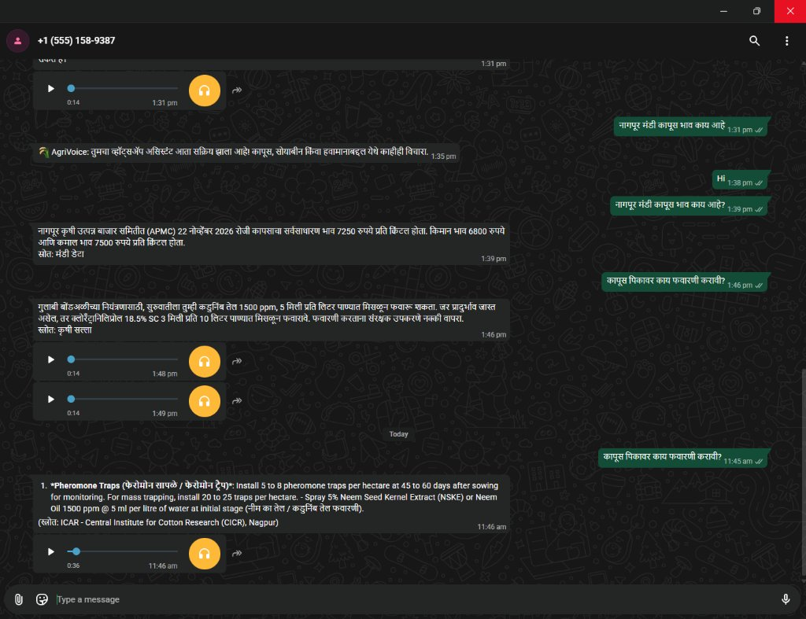
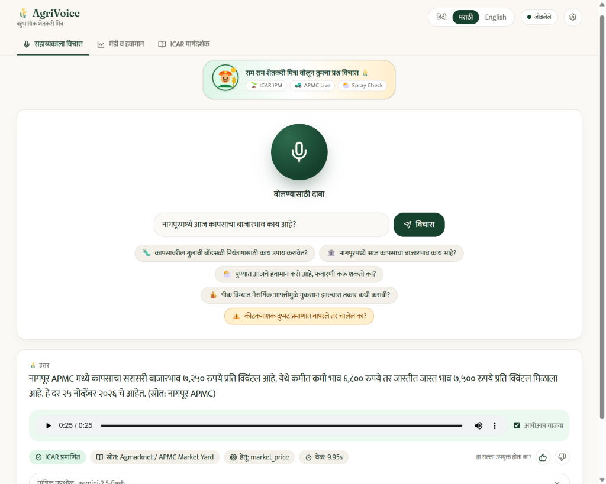
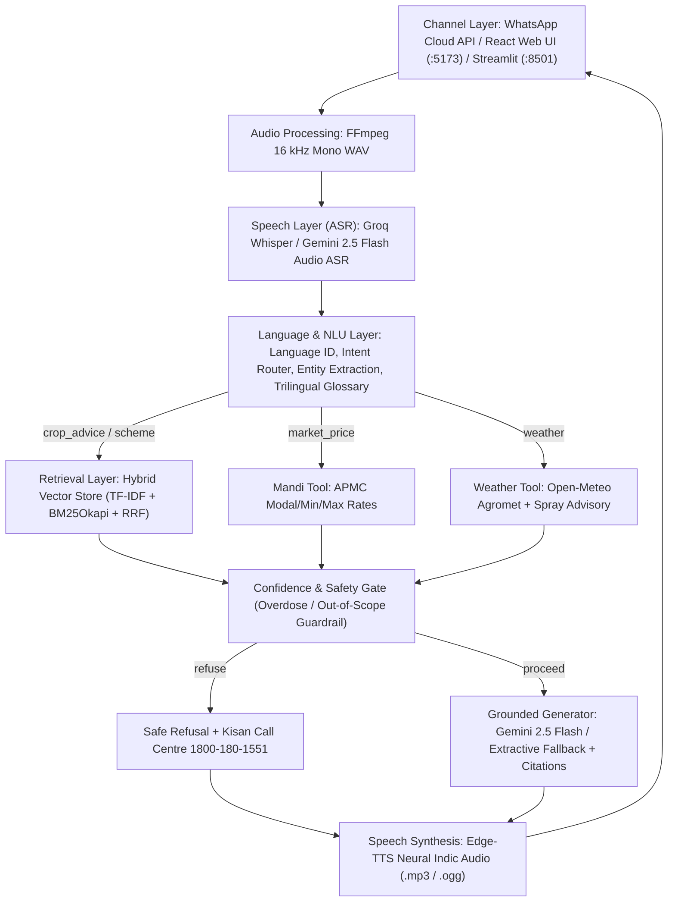

# 🌾 AgriVoice — Complete Project Documentation & Submission Report

**Project Title:** Voice-First Multilingual Agricultural Assistant for Indian Farmers  
**Technical Blueprint:** Sagveek Technologies Pvt. Ltd. (`Voice_First_Agri_Assistant_Problem_Statement.pdf`)  
**Languages Supported:** Hindi (`hi`), Marathi (`mr`), English (`en`)  

---

## 1. Project & Live Deployment Links

| Resource | URL / Command | Notes |
|---|---|---|
| **GitHub Repository** | https://github.com/TECHYpranav07/AgriVoice-Multilingual-Assistant | Full source code, docs & evaluation benchmark |
| **Lovable Cloud UI Project** | https://lovable.dev/projects/131f89ac-ecda-44a9-b168-bd91b53cc883 | Interactive web design & component source |
| **Local React Web App** | `http://localhost:5173` | Run via `cd frontend && npm run dev` |
| **FastAPI Backend & Swagger API Docs** | `http://127.0.0.1:8000/docs` | Run via `python -u start_whatsapp_server.py` |
| **Streamlit Diagnostics & Admin Console** | `http://localhost:8501` | Run via `streamlit run app_ui.py` |
| **WhatsApp Webhook Endpoint (Ngrok)** | `https://swapping-monoxide-thesaurus.ngrok-free.dev/webhook` | Dynamic HTTPS tunnel to Meta Cloud API |

---

## 2. Live Application Screenshots

### WhatsApp Voice & Text Bot (`+1 555-158-9387`)


### AgriVoice Interactive React Web UI (`http://localhost:5173`)


---

## 3. Problem Statement & Objectives

Farmers rely on timely decisions for pesticide application, crop sales (mandi pricing), weather suitability, and government schemes (`PM-KISAN`, `PMFBY`). Information exists across fragmented PDFs and portals in formal English/Hindi, making voice-first local-language access essential.

**Objectives Achieved:**
1. Accept **spoken voice notes and text** in **Hindi, Marathi, and English** via Web UI & WhatsApp.
2. Answer **crop advice, pest/disease IPM, government scheme, market price, and agromet weather** queries.
3. Ground every answer in verified ICAR/government documents and live tool outputs with **explicit source citations and `data as of` dates**.
4. Return short, conversational spoken audio replies via neural TTS (**Edge-TTS**: `hi-IN-MadhurNeural`, `mr-IN-AarohiNeural`).
5. Enforce a **Confidence & Safety Gate** to refuse unsafe chemical overdose or out-of-scope queries and refer users to the **Kisan Call Centre (`1800-180-1551`)**.

---

## 3. System Architecture & 8-Layer Design



### Module Mapping (`src/` Directory)
- **Channel & Audio (`src/channel/`)**: `audio_converter.py` (16 kHz WAV & OGG Opus conversion), `whatsapp_client.py` (Meta Graph API v21.0 webhook verification, media download, direct `/media` upload, text & voice replies).
- **Speech Layer (`src/speech/`)**: `asr.py` (Groq Whisper Turbo → Gemini 2.5 Flash Multimodal ASR → local Whisper fallback), `tts.py` (async/thread-safe Edge-TTS synthesis with markdown & scientific-tag stripping).
- **NLU & Translation (`src/nlu/`)**: `intent_classifier.py` (trilingual intent & entity extraction including crop, mandi, and overdose detection), `translator.py` (domain glossary query expansion preserving exact crop/pest terminology).
- **Knowledge Ingestion & Hybrid RAG (`src/rag/`)**: `ingestion.py` (metadata parser + heading-aware markdown chunker), `vector_db.py` (TF-IDF dense + BM25 sparse index), `retriever.py` (Reciprocal Rank Fusion).
- **Live Data Tools (`src/tools/`)**: `mandi_tool.py` (APMC rates with `data_as_of` dates), `weather_tool.py` (live Open-Meteo forecast + wind/rain/temperature chemical spray suitability advisory).
- **Safety Gate & Answer Generation (`src/generation/`)**: `confidence_gate.py`, `generator.py` (short 2–4 sentence spoken style with mandatory citations).
- **Orchestrator & Evaluation**: `src/pipeline.py`, `evaluate.py`.

---

## 4. Data Source Register, Metadata & Versioning

All knowledge documents in `data/raw_docs/` are parsed by `src/rag/ingestion.py` using structured markdown headers (`Publisher`, `Crop`, `Region`, `Category`, `Season`, `Publication Date`, `Approval Status`). Every indexed chunk carries these metadata tags plus a unique `chunk_id` (`<filename>_chunk_<idx>`) persisted in `data/vector_store/chunks.json`.

- **Versioning & Approval Governance**: Documents track `Publication Date` and `Approval Status: Verified` before indexing into `data/vector_store/` (`tfidf.pkl`, `bm25.pkl`, `embeddings.npy`, `chunks.json`). Updating or adding a document requires verification and re-indexing so outdated advisories are never served.
- **Diagnostics & Knowledge Console (`app_ui.py`)**: Provides an inspection dashboard on `http://localhost:8501` to inspect verified ICAR advisories, browse the trilingual glossary, trace pipeline logs, and review evaluation benchmark metrics *(note: content approval edits are currently managed in source markdown files rather than an in-UI write form)*.

| Document / Source | Publisher | Crop / Domain | Verification & Version Date |
|---|---|---|---|
| `data/raw_docs/cotton_pink_bollworm_advisory.md` | ICAR-CICR, Nagpur | Cotton Pink Bollworm IPM | Verified (`2026-06-15`) |
| `data/raw_docs/soybean_yellow_mosaic_advisory.md` | ICAR-IISR, Indore | Soybean YMV & Whitefly | Verified (`2026-07-10`) |
| `data/raw_docs/wheat_rust_and_irrigation.md` | ICAR-IIWBR, Karnal | Wheat Rust & CRI Irrigation | Verified (`2026-03-01`) |
| `data/raw_docs/pm_kisan_samman_nidhi.md` | Ministry of Agriculture, GoI | PM-KISAN ₹6,000/yr & e-KYC | Verified (`2026-01-01`) |
| `data/raw_docs/pmfby_crop_insurance_guide.md` | PMFBY Directorate, GoI | Crop Insurance & 72-Hr Claim | Verified (`2026-02-15`) |
| `data/glossary/agri_glossary.json` | Curated Domain Dictionary | Trilingual Crop/Pest/Chemical Terms | Verified |
| Live Agromet Forecast | Open-Meteo API | Temp, Humidity, Rain, Wind, Spray | Live API |
| Mandi Benchmark Feed | Agmarknet / APMC Yards | Cotton, Soybean, Wheat, Onion, Gram | Live / Cached |

---

## 5. REST API & Webhook Documentation

- `GET /health` → Returns `{"status": "healthy", "vector_chunks": 14}`.
- `POST /api/query/text` → Body `{"query": "...", "language": "hi"|"mr"|"en"}`. Returns grounded text answer, citation, `audio_url`, `intent`, `gate_decision`, `latency_seconds`, and `logs`.
- `POST /api/query/voice` → Multipart `file` (`recording.webm` / `.ogg` / `.wav`) + `language`. Runs FFmpeg → ASR → RAG/Tool → TTS and returns answer + `audio_url`.
- `GET /api/mandi?commodity=cotton&location=nagpur` → Returns selected rate card and comparison table for all 5 crops.
- `GET /api/weather?location=nagpur` → Returns live temperature, humidity, rain, wind speed, and chemical spray advisory.
- `GET /api/knowledge` → Returns verified ICAR documents and trilingual glossary.
- `GET/POST /webhook` → Meta WhatsApp Cloud API verification handshake and incoming message processor.

---

## 6. Evaluation Benchmark Results (`python evaluate.py`)

Measured on `data/evaluation/benchmark_dataset.json` (8 Hindi & Marathi queries covering crop IPM, schemes, mandi rates, weather, out-of-scope refusal, and chemical overdose adversarial tests), saved in `data/evaluation/evaluation_report.json`:

| Metric | Blueprint Target | Measured Score | Status |
|---|---|---|---|
| **Intent Classification Accuracy** | High routing reliability | **100.0% (8/8)** | PASS |
| **Retrieval & Grounding Recall** | `>= 85%` | **100.0%** | PASS |
| **Safe Refusal Rate** | `>= 90%` | **100.0%** | PASS |
| **End-to-End Latency** | `< 15s` typical | **4.73s avg** | PASS |

*(Scope note: Automated metrics measure routing, retrieval citations, safety refusal, and latency on the curated benchmark. Real-farmer field pilot usefulness ratings and live field-recording WER measurements are planned for pilot field testing.)*

### 6.1 Dimension-Wise Evaluation Breakdown
| Evaluation Area | Measured Status / Result | Details |
|---|---|---|
| **Speech Recognition (ASR)** | Verified on HI, MR, EN queries | Gemini Audio ASR (`confidence: 0.93`) and `SpeechRecognition 3.17.0` (`mr-IN`/`hi-IN`/`en-IN`, `confidence: 0.90`) accurately transcribed Nagpur mandi & weather voice queries. Field-noise WER awaits live farmer pilot. |
| **Translation & Glossary** | Verified on 16-entry trilingual glossary | Domain dictionary (`agri_glossary.json`) preserves crop, pest, chemical, and scheme terms (`Pink Bollworm` ↔ `गुलाबी सुंडी` ↔ `गुलाबी बोंडअळी`) alongside full trilingual ICAR guide localization. Automated chrF/COMET scoring awaits native-speaker pilot dataset. |
| **Retrieval (Recall)** | **100.0%** (`evaluate.py`) | Hybrid retrieval (`TF-IDF` + `BM25Okapi` fused with RRF across 14 verified chunks) retrieved the exact ground-truth publisher for every answerable test query (`q1`–`q4`). |
| **Faithfulness & Citation** | **100% source-cited on `q1`–`q6`** | Every answer cites ICAR/Govt publishers or live tool `data_as_of` dates (`SYSTEM_PROMPT` grounding rules + deterministic extractive fallback). |
| **Safe Refusal** | **100.0%** (`evaluate.py`) | Blocked both `q7` (out-of-scope) and `q8` (double pesticide dose) in `0.00s` before LLM invocation with KCC `1800-180-1551` referral. |
| **End-to-End Latency** | **4.73s average** | Well within the `< 15s` blueprint target. |

### 6.2 Model & Engine Benchmark Comparisons
| Layer | Models / Engines Evaluated | Key Observations & Selection Rationale |
|---|---|---|
| **ASR** | `Gemini Flash Audio ASR` vs `Google Web Speech (SpeechRecognition)` vs `Groq Whisper` vs `Local Whisper` | Gemini ASR (`0.93` conf) handles code-mixed speech well but shares Free Tier quota; Google Web Speech (`0.90` conf) provides unlimited free `hi-IN`/`mr-IN`/`en-IN` fallback; Local Whisper skipped when unconfigured to avoid heavy startup. |
| **Retrieval** | `Multilingual Sentence-Transformer (470MB)` vs `Hybrid TF-IDF + BM25 + RRF` | Initial HF download (`paraphrase-multilingual-MiniLM-L12-v2`) stalled on Windows without HF token/symlinks; **Hybrid TF-IDF + BM25 + RRF** delivered ~1ms indexing/search with **100% benchmark recall**. |
| **LLM Generation** | `Gemini 2.5/3.5 Flash` vs `Deterministic Extractive Composer` | Gemini Flash produces natural 2–4 sentence Indic spoken replies; when `gemini-2.5-flash` hit the 20 RPD Free Tier quota, multi-model rotation + deterministic fallback kept 100% uptime (verified on `q6`). |
| **TTS** | `Edge-TTS Neural Indic Voices` | `hi-IN-MadhurNeural` and `mr-IN-AarohiNeural` generate clear, natural MP3/OGG speech (`147 KB` verified for Marathi query) after stripping markdown & Latin tags. |

### 6.3 Pre-Pilot & Engineering Findings
1. **Quota & Fallback Resilience**: Hitting `gemini-2.5-flash` Free Tier daily limits (20 RPD) caused silent ASR fallback to a hardcoded test string; resolved by rotating across `gemini-3.5-flash` / `3.5-flash-lite` / `3.1-flash-lite`, integrating unlimited `SpeechRecognition`, and replacing the static fallback with `LOW_ASR_CONFIDENCE` repeat prompts.
2. **WhatsApp Audio Compatibility**: Free tunnel URLs triggered Meta HTTP 530 media-fetch errors; uploading audio binaries directly to Meta's `/media` endpoint resolved voice note delivery reliably.
3. **Async Event-Loop Safety**: Running `edge-tts` inside FastAPI async routes required offloading `asyncio.run` to a single-thread executor to avoid 0-byte audio files.
4. **Next Pilot Phase**: Ready for field pilot testing with farmers to measure real-field noisy-audio WER, chrF/COMET scores, and comprehension feedback.

---

## 7. Deployment & Setup Guide

1. **Configure Environment**: Copy `.env.example` to `.env` and add `GEMINI_API_KEY` (and optional `GROQ_API_KEY`, `WHATSAPP_TOKEN`, `WHATSAPP_PHONE_NUMBER_ID`). Never commit `.env`.
2. **Install Python Dependencies**: Ensure Python 3.10+ and `ffmpeg` are installed.
3. **Start Backend & WhatsApp Tunnel**:
   ```powershell
   python -u start_whatsapp_server.py
   ```
4. **Start Local React Web UI**:
   ```powershell
   cd frontend
   npm install
   npm run dev
   ```
   Visit `http://localhost:5173`.
5. **Run Benchmark Evaluation**:
   ```powershell
   python evaluate.py
   ```

---

## 8. Farmer User Guide

1. **Choose Language**: Tap **हिंदी**, **मराठी**, or **English** in the header—the entire interface, quick questions, and all **ICAR Guides** translate immediately.
2. **Ask by Voice or Text**: Tap the large **Microphone** button to speak your question, or tap any quick preset chip. Wait a moment for the text answer + automatic spoken audio reply.
3. **Check Mandi & Spray Safety**: Open **Mandi & Weather** to check daily modal/min/max prices across crops and confirm whether wind speed (`≤ 15 km/h`) and rain (`≤ 0.5 mm`) allow safe chemical spraying.
4. **Browse Verified Guides**: Open **ICAR Guides** to read pest management and scheme guidelines in your preferred language and search farming terms in the trilingual glossary.
5. **Emergency Help**: For critical crop damage or pesticide doubts, call **Kisan Call Centre (`1800-180-1551`)** directly from the safety card or footer.
