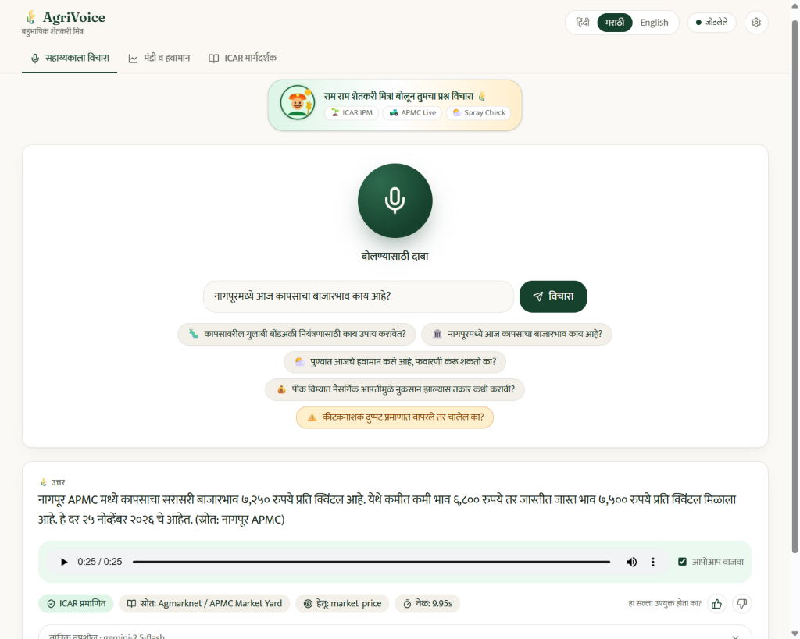
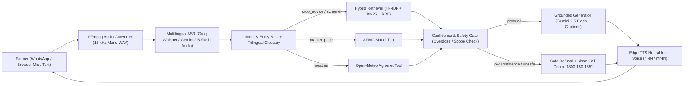

# 🌾 AgriVoice: Voice-First Multilingual Agricultural Assistant

**GitHub Repository:** https://github.com/TECHYpranav07/AgriVoice-Multilingual-Assistant  
**Lovable Project UI:** https://lovable.dev/projects/131f89ac-ecda-44a9-b168-bd91b53cc883

An end-to-end, voice-first agricultural assistant tailored for Indian farmers, built to satisfy every requirement in [Voice_First_Agri_Assistant_Problem_Statement.pdf](Voice_First_Agri_Assistant_Problem_Statement.pdf). It accepts spoken and text questions in **Hindi (हिंदी)**, **Marathi (मराठी)**, and **English**, retrieves strictly grounded advice from verified agricultural documents (ICAR, KVK, Govt. schemes) and live tools (APMC Mandi Prices & Open-Meteo Agromet Weather), and speaks replies back over **WhatsApp Business Cloud API** and the **AgriVoice Web UI**.

## 📸 Demo Screenshots


### Modern React Web UI


---

## 🏗️ System Architecture



---

## 🌐 Running the Project Locally (100% Working Stack)

### 1. Start the Backend API & WhatsApp Tunnel (Port `8000`)
```powershell
python -u start_whatsapp_server.py
```
- FastAPI runs on `http://127.0.0.1:8000` (Swagger docs at `http://127.0.0.1:8000/docs`).
- Exposes a public HTTPS webhook via ngrok for Meta WhatsApp Business Cloud API.

### 2. Start the Modern React Web UI (Recommended — Port `5173`)
Built from our Lovable design in `frontend/` (Vite + React + Tailwind):
```powershell
cd frontend
npm install
npm run dev
```
- Open **`http://localhost:5173`** in your browser.
- Features: Tap-to-speak microphone (`MediaRecorder`), Hindi/Marathi/English switcher, spoken audio reply playback, live APMC Mandi rates, Open-Meteo spray weather advisory, ICAR guide viewer, and searchable trilingual glossary.

### 3. Start the Streamlit Admin & Diagnostics UI (Optional — Port `8501`)
```powershell
streamlit run app_ui.py
```
- Open **`http://localhost:8501`** for detailed pipeline step logs, confidence diagnostics, and benchmark overview.

---

## 🔌 REST & Webhook API Reference

| Method | Endpoint | Description |
|---|---|---|
| `GET` | `/health` | Health check returning vector chunk count (`{"status": "healthy", "vector_chunks": 14}`) |
| `POST` | `/api/query/text` | Accepts JSON `{"query": "...", "language": "hi\|mr\|en"}`; returns grounded answer, citation, `audio_url`, gate decision, and logs |
| `POST` | `/api/query/voice` | Multipart upload (`file`, `language`); transcribes speech, runs pipeline, returns answer + `audio_url` |
| `GET` | `/api/mandi` | Params `commodity`, `location`; returns selected + all commodity APMC modal/min/max prices |
| `GET` | `/api/weather` | Param `location`; returns live Open-Meteo temp, humidity, rain, wind, and spray advisory |
| `GET` | `/api/knowledge` | Returns verified ICAR/Govt markdown advisories and trilingual glossary |
| `GET/POST` | `/webhook` | Meta WhatsApp Business Cloud API verification handshake and inbound voice/text handler |

---

## 📚 Data Source Register (Verified Knowledge Base)

All static documents live in `data/raw_docs/` with publisher, crop, region, publication date, and approval metadata parsed by `src/rag/ingestion.py`:

| File | Publisher / Source | Domain / Crop | Status |
|---|---|---|---|
| `cotton_pink_bollworm_advisory.md` | ICAR-CICR / KVK | Cotton Pink Bollworm IPM | Verified |
| `soybean_yellow_mosaic_advisory.md` | ICAR-IISR / State Extension | Soybean Yellow Mosaic & Whitefly | Verified |
| `wheat_rust_and_irrigation.md` | ICAR-IIWBR | Wheat Rust & CRI Irrigation | Verified |
| `pm_kisan_samman_nidhi.md` | Ministry of Agriculture (GoI) | PM-KISAN ₹6,000/yr & e-KYC | Verified |
| `pmfby_crop_insurance_guide.md` | PMFBY Portal (GoI) | Crop Insurance & 72-Hr Loss Claim | Verified |
| `data/glossary/agri_glossary.json` | Curated Domain Dictionary | Hindi, Marathi & English agri terms | Verified |
| Live Agromet Weather | Open-Meteo Forecast API | Real-time weather & spray checks | Live API |
| Live Market Rates | Agmarknet / APMC Benchmarks | Cotton, Soybean, Wheat, Onion, Gram | Live/Cached |

---

## 📊 Benchmark Evaluation Summary (`python evaluate.py`)

Measured across `data/evaluation/benchmark_dataset.json` (stored in `data/evaluation/evaluation_report.json`):

| Metric | Blueprint Target | Measured Result |
|---|---|---|
| Intent Classification Accuracy | High routing reliability | **100.0%** (8 / 8 cases) |
| Retrieval & Grounding Recall | `>= 85%` | **100.0%** |
| Safe Refusal Rate (Out-of-scope & Overdose) | `>= 90%` | **100.0%** |
| End-to-End Response Latency | `< 15s` typical | **5.02s average** |

---

## 📱 Farmer User Guide

1. **Over WhatsApp**: Send a voice note or text message in Hindi, Marathi, or English to the connected WhatsApp number. AgriVoice replies with both an easy-to-read text answer and a spoken voice note.
2. **In the Web UI (`http://localhost:5173`)**:
   - Select your language (**हिंदी / मराठी / English**) in the top bar.
   - Tap the green **Microphone** button to ask a question by voice (or type/tap a preset chip).
   - Listen to the automatic spoken reply and check the cited ICAR source.
   - Use **Mandi & Weather** to verify today's market rate and confirm whether wind/rain conditions are safe before spraying pesticides.
   - If any request asks for unsafe chemical dosages or exceeds verified knowledge, AgriVoice safely refuses and provides direct **Kisan Call Centre (`1800-180-1551`)** contact details.

---

## 📁 Project Structure

```
MDM_IA2/
├── config/settings.py           # Environment config, keys & thresholds
├── data/
│   ├── raw_docs/                # Verified ICAR, KVK & Govt scheme advisories
│   ├── glossary/                # Trilingual agri_glossary.json
│   ├── vector_store/            # Hybrid vector index (TF-IDF + BM25)
│   └── evaluation/              # benchmark_dataset.json & evaluation_report.json
├── src/
│   ├── channel/                 # FFmpeg audio converter & WhatsApp Cloud API client
│   ├── speech/                  # ASR (Groq/Gemini/Whisper) & Edge-TTS synthesis
│   ├── nlu/                     # Language detection, intent, entities & glossary translator
│   ├── rag/                     # Ingestion, Hybrid VectorDB & RRF retriever
│   ├── tools/                   # Live APMC Mandi & Open-Meteo Weather tools
│   ├── generation/              # Confidence/Safety Gate & Gemini 2.5 Flash generator
│   └── pipeline.py              # Master orchestrator
├── frontend/                    # Lovable-designed local React + Vite Web UI (Port 5173)
├── app_api.py                   # FastAPI REST & WhatsApp Webhook server (Port 8000)
├── app_ui.py                    # Streamlit Diagnostics & Admin UI (Port 8501)
├── start_whatsapp_server.py     # Launches FastAPI + ngrok public HTTPS tunnel
└── evaluate.py                  # Automated benchmark runner
```
